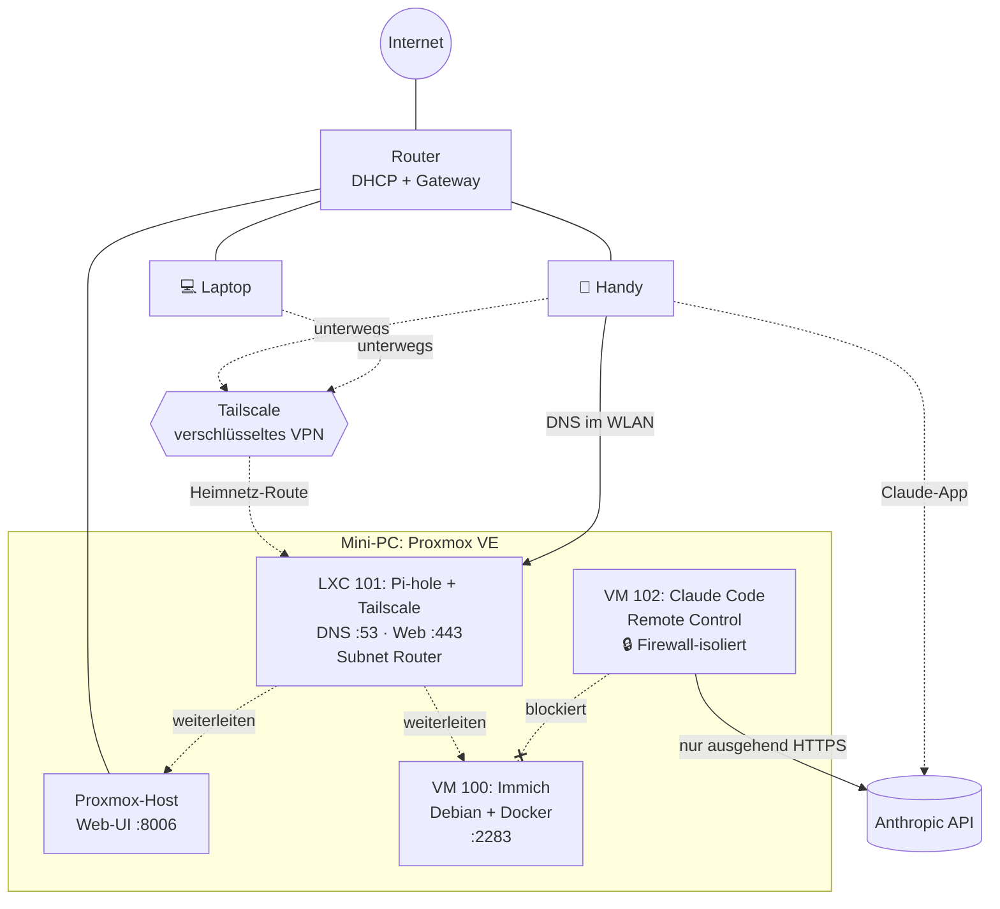

# 🏠 Homelab

Mein selbst gebautes Homelab auf einem Mini-PC: Virtualisierung mit **Proxmox VE**, eigene Foto-Cloud mit **Immich**, netzweiter Werbeblocker mit **Pi-hole**, sicherer Fernzugriff über **Tailscale** und eine abgeschottete VM, in der **Claude Code** als KI-Agent arbeitet.

Das Projekt dient mir zum Lernen Richtung **Cybersecurity / Security Engineering**. Darum ist jeder Schritt mit dem **Was** und dem **Warum** dokumentiert, nicht nur mit dem Befehl. Viele Entscheidungen drehen sich um Sicherheit: Least Privilege, Netzwerksegmentierung, geprüfte Downloads, keine offenen Ports.

> **Hinweis:** Dieses Repo ist bewusst bereinigt. Konkrete IP-Adressen, Benutzernamen, Passwörter und Schlüssel stehen hier nicht drin. Stattdessen werden Platzhalter wie `<PVE-IP>` verwendet (siehe [Netzwerk](docs/02-netzwerk.md#platzhalter)).

---

## Inhalt

| # | Kapitel | Thema |
|---|---|---|
| 01 | [Planung & Hardware](docs/01-planung-hardware.md) | Anforderungen, Wahl des Mini-PCs, Boot-Stick |
| 02 | [Netzwerk](docs/02-netzwerk.md) | IP-Plan, DHCP-Bereich, CGNAT, DNS |
| 03 | [Proxmox VE](docs/03-proxmox.md) | Installation, Update-Quellen, Updates, 2FA |
| 04 | [Immich (Foto-Cloud)](docs/04-immich.md) | Debian-VM, Docker, Immich |
| 05 | [Pi-hole (DNS-Adblocker)](docs/05-pihole.md) | LXC-Container, Blocklisten, Fehlersuche |
| 06 | [Tailscale (VPN)](docs/06-tailscale.md) | Subnet Router im Container, Fernzugriff |
| 07 | [Claude-Code-VM](docs/07-claude-code-vm.md) | KI-Agent mit Remote Control vom Handy |
| 08 | [Firewall & Segmentierung](docs/08-firewall.md) | Claude-VM vom Heimnetz isolieren |
| 09 | [Betrieb](docs/09-betrieb.md) | Start-Reihenfolge, Ausschalten, Updates |
| 10 | [Lessons Learned](docs/10-lessons-learned.md) | Fehlersuche und was ich gelernt habe |
| – | [Spickzettel](cheatsheet.md) | Die wichtigsten Befehle |
| – | [Roadmap](#roadmap) | Was als Nächstes kommt |

---

## Hardware

| Komponente | Details |
|---|---|
| Server | Mini-PC |
| RAM | 32 GB |
| Speicher | 1 TB NVMe-SSD |
| Netzwerk | Gigabit-LAN per Kabel am Router |
| Betrieb | headless (nur Strom + LAN), tagsüber an, nachts aus |

---

## Architektur

---

## Dienste

| ID | Name | Typ | Betriebssystem | Ressourcen | Ports | Zweck |
|---|---|---|---|---|---|---|
| – | Proxmox VE | Host | Debian 13 (Proxmox 9.2) | ganzer Server | 8006 (Web), 22 (SSH) | Virtualisierung |
| 100 | `immich` | VM | Debian 13 | 4 Kerne, 6 GB RAM, 50 GB | 2283 (Web), 22 | Foto-Cloud |
| 101 | `pihole` | LXC (unprivileged) | Debian 13 | 1 Kern, 512 MB RAM, 8 GB | 53 (DNS), 80/443 (Web) | DNS-Adblocker + Tailscale Subnet Router |
| 102 | `claude` | VM | Debian 13 | 2 Kerne, 4 GB RAM, 32 GB | 22 (nur aus dem Heimnetz) | Claude Code mit Remote Control |

---

## Sicherheitskonzept in Kürze

- **Keine offenen Ports im Router.** Fernzugriff läuft ausschliesslich über Tailscale. Der Internetanschluss nutzt ohnehin CGNAT.
- **2FA** (TOTP + Recovery-Keys) für den Proxmox-Login.
- **Downloads prüfen:** ISO per SHA256 verifiziert, Installationsskripte vor dem Ausführen mit `less` gelesen und auf fremde URLs geprüft.
- **Least Privilege:** Pi-hole läuft als *unprivileged* LXC; Debian-VMs ohne root-Passwort, nur `sudo`; Claude Code ohne root.
- **Netzwerksegmentierung:** Die Claude-VM darf nur ins Internet und zum Router-DNS, aber kein anderes Gerät im Heimnetz erreichen (Proxmox-Firewall + IPv6 deaktiviert). Siehe [Kapitel 08](docs/08-firewall.md).
- **Snapshots** vor riskanten Änderungen.
- **Datenschutz:** Pi-hole nutzt Quad9 (DNSSEC, ohne ECS) als Upstream-DNS.

---

## Roadmap

Das Homelab wächst laufend. **Weitere Projekte kommen dazu**, und diese Liste wird regelmässig ergänzt.

**Basis**
- [x] Proxmox VE installieren und absichern (Updates, 2FA)
- [x] Immich als Foto-Cloud
- [x] Pi-hole als DNS-Adblocker
- [x] Tailscale für Fernzugriff
- [x] Claude-Code-VM mit Remote Control
- [x] Firewall-Isolation der Claude-VM
- [ ] Backups der VMs/Container auf externe HDD (Proxmox Backup-Jobs)
- [ ] Fotos importieren (mit Offline-Kopie auf HDD → 3-2-1-Regel)
- [ ] SSH-Schlüssel statt Passwörter, Passwort-Login abschalten
- [ ] Automatisches Herunterfahren abends / Einschalten morgens
- [ ] Autostart von Claude Code Remote Control (systemd)
- [ ] HTTPS für Immich (Reverse Proxy oder Tailscale HTTPS)
- [ ] Pi-hole auch unterwegs über Tailscale-DNS

**Härtung**
- [ ] Proxmox-Host-Firewall (Web-UI und SSH nur aus dem Heimnetz / Tailnet)
- [ ] Tailscale ACLs (wer darf was erreichen)
- [ ] Tailscale Tailnet Lock

**Eigene Projekte**
- [ ] Security-Lab: Lern-VMs (Angreifer + verwundbare Ziele) in isoliertem Netz
- [ ] Monitoring (z. B. Uptime Kuma), später SIEM (z. B. Wazuh)
- [ ] Home Assistant + Zigbee: Türsensor, Smart Lights, Türmeldung
- [ ] „Jarvis": eigener Sprachassistent mit Weckwort, nur über VPN erreichbar

**Ideen für später**
- [ ] Dashboard-Startseite mit allen Diensten (z. B. Homepage / Homarr)
- [ ] Automatisierung des Setups als Code (z. B. Ansible)
- [ ] Uptime Kuma als Monitoring
- [ ] … und was mir sonst noch einfällt 🚀
